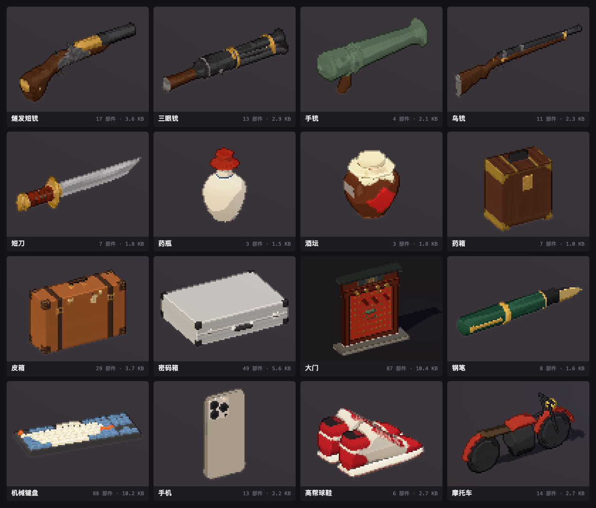
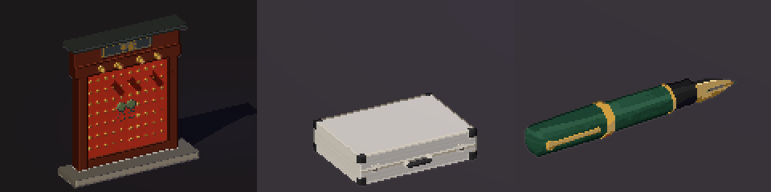
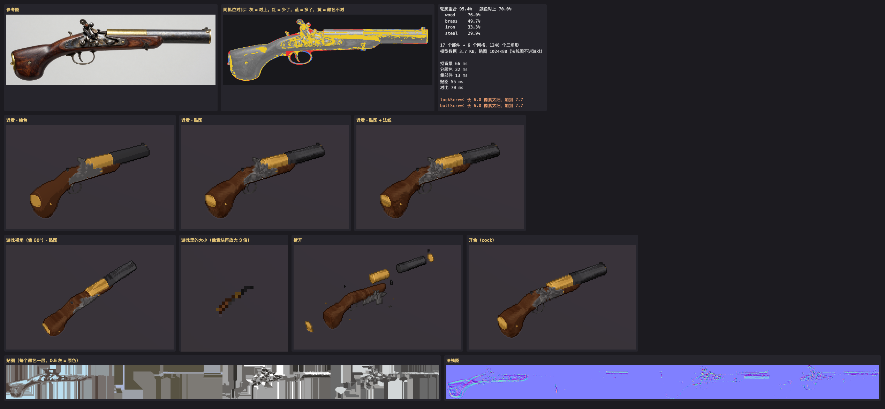
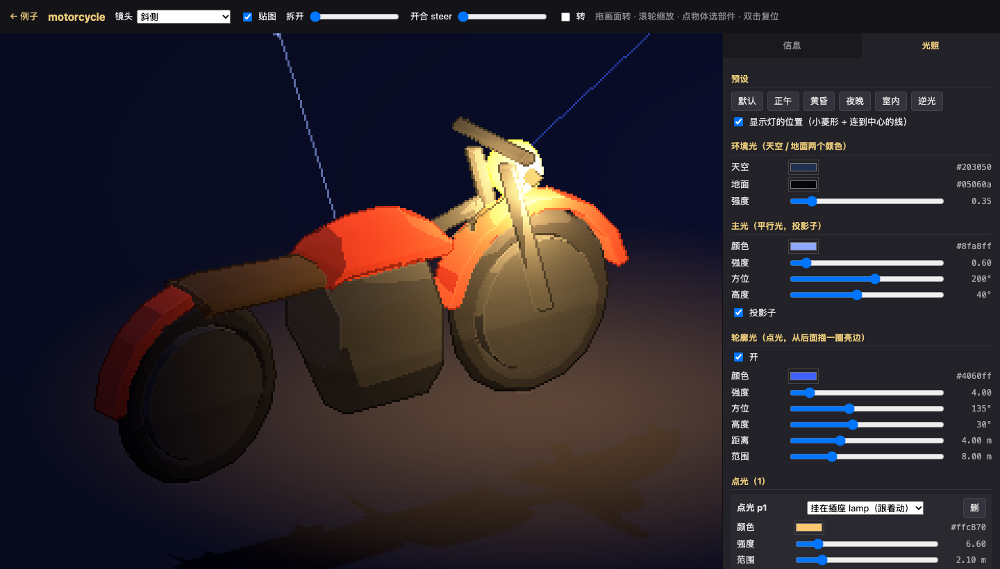

<p align="center">
  
</p>

<h1 align="center">img2prop</h1>

<p align="center">
  一张参考图，变成像素风游戏里拿得起、打得开、拆得散的 3D 道具。<br>
  <sub>给 AI agent 用的建模技能 · 只依赖 three · 全程在本机</sub>
</p>

<br>

分工是这样的：**工具负责量，AI 负责认。**

工具抠背景、分颜色，按框量出每一列的上下沿和粗细，把参考图照同一个机位烘成贴图，最后渲一张同机位对比图打分。
AI 只看一张标着像素坐标的网格图，写一张几十行的部件表：这一段是铳管，这一块是机头板，这些红点是门钉。
人眼读坐标会差上十几个像素，尺寸就不交给它。

出来的是几 KB 的部件数据加一张小贴图。游戏里调一次 `buildProp()` 就得到 `THREE.Group`。

<p align="center">
  <br>
  <sub>大门：拔门闩，两扇往里开 · 密码箱：弹开锁扣，掀盖，里面是钞票 · 钢笔：拔帽，调个头，套上</sub>
</p>

## 一件道具怎么来

1. **参考图**：正侧面或正面，平涂，纯色背景。ComfyUI 一次出三张，挑轮廓最清楚的那张。
2. **看图**：`node scripts/prop.mjs <文件夹> trace`，得到四边标着坐标的网格图和调色板。
3. **写部件表**：坐标直接从网格上读。工具量得出来的只给框和颜色，不写尺寸。
4. **生成**：一秒左右，出模型数据、贴图和一张审图。一般改两三轮。

```jsonc
// examples/gate/prop.json（节选）
{ "id": "leafL", "kind": "box", "color": "red", "box": [440, 240, 700, 770], "t": 20,
  "open": { "pivot": [440, 505, -10], "axis": "v", "deg": 90 } },          // 门扇绕门轴往里开
{ "id": "studL", "kind": "cyl", "color": "brass", "box": [440, 240, 700, 770],
  "each": true, "dir": "w", "len": 10, "on": "leafL" }                      // 门钉：框里每颗铜点一个，跟着门扇走
```

每件都出一张审图：同机位对比（红是少了，蓝是多了），像素风近看，游戏里的大小，拆开的样子。

<p align="center"></p>

## 例子

| 道具 | 参考图 | 部件 | 网格 | 三角形 | 数据 + 贴图 | 轮廓重合 | 会动 |
|---|---|--:|--:|--:|--:|--:|---|
| 燧发短铳 | ComfyUI | 17 | 6 | 1248 | 3.7 + 11.5 KB | 95.4% | 扳击锤 |
| 三眼铳 | ComfyUI | 13 | 4 | 1376 | 3.0 + 5.8 KB | 97.4% | |
| 手铳 | ComfyUI | 4 | 2 | 1176 | 2.1 + 4.2 KB | 99.0% | |
| 鸟铳 | ComfyUI | 11 | 6 | 1056 | 2.4 + 5.5 KB | 93.4% | |
| 短刀 | ComfyUI | 7 | 3 | 896 | 1.9 + 4.3 KB | 93.7% | |
| 药瓶 | ComfyUI | 3 | 3 | 944 | 1.6 + 7.3 KB | 99.1% | |
| 酒坛 | ComfyUI | 3 | 3 | 1040 | 1.8 + 9.4 KB | 99.2% | |
| 药箱 | ComfyUI | 7 | 3 | 276 | 1.0 + 19.3 KB | 95.7% | |
| 皮箱 | 程序画的 | 29 | 17 | 1044 | 3.8 + 11.4 KB | 99.4% | 开锁扣，开盖 |
| 密码箱 | 程序画的 | 49 | 20 | 920 | 5.9 + 7.3 KB | 99.4% | 弹锁扣，掀盖 |
| 大门 | 程序画的 | 87 | 80 | 2388 | 10.8 + 22.1 KB | 99.8% | 开门，叩门 |
| 钢笔 | 程序画的 | 8 | 6 | 368 | 1.7 + 3.8 KB | 97.8% | 套帽 |
| 机械键盘 | 程序画的 | 88 | 4 | 1420 | 10.7 + 11.1 KB | 99.4% | |
| 手机 | 程序画的 | 13 | 6 | 556 | 2.3 + 5.7 KB | 99.3% | |
| 高帮球鞋 | 程序画的 | 6 | 1 | 1120 | 2.7 + 3.7 KB | 99.7% | |
| 摩托车 | 程序画的 | 14 | 12 | 1140 | 2.8 + 5.2 KB | 96.5% | 打方向 |

「程序画的」参考图由每件文件夹里的 `draw-reference.mjs` 在 canvas 上画出来，平涂、颜色干净，所以重合率偏高。
衡量真实出图的效果，看前八件。

工具跑一次一秒左右。拿到参考图以后，一件道具一般两三分钟做完，大半时间在看图和写部件表。
同一把燧发短铳，[img2threejs](https://github.com/img2threejs/img2threejs) 做了一个多小时，生成 177 KB 代码，轮廓重合 87.8%；
这里是 3.7 KB 数据加 11.5 KB 贴图，95.4%。

## 开合、拆开、打光

**开合**：部件可以绕轴转、平移，也可以几步接着来（先拔门闩，再开门）。装在它上面的部件跟着动，几个动作可以分开放。

```ts
const m = buildProp(data, { map: texture });
m.actions;               // ['open', 'knock']
m.pose(0, { open: 1 });  // 只开门，门环不动
```

**拆开**：默认按层拆，叠在外面的往外弹，本体在图平面里散开。测量时切开的几段用 `group` 绑在一起，装配关系用 `on` 写。

**打光**：例子页点一件进详情页，能看部件表、颜色、插座，能调灯：环境光、主光、轮廓光，任意几盏点光（可以挂在插座上，跟着物体转、跟着开合动）。
调好的灯可以导出成 JSON，游戏里 `new LightRig(scene).apply(json.lights, model.sockets)` 原样用上。

<p align="center"></p>

## 装

要 Node ≥ 22.18 和本机的 Chrome（或 Chromium，找不到就设 `CHROME_PATH`）。

```bash
git clone https://github.com/xiwan/img2prop ~/.claude/skills/img2prop   # 或者放进项目的 .claude/skills/
cd ~/.claude/skills/img2prop && npm install --omit=dev                   # 只装 three
```

## 用

```bash
node scripts/prop.mjs examples/pen trace     # 看图：out/trace.png
node scripts/prop.mjs examples/pen           # 生成：out/pen.json、pen.png、review.png
node scripts/prop.mjs my/item --out game/models
npm run examples && npm run dev              # 全部重新生成，打开 http://127.0.0.1:5199/viewer/
npm test                                     # node --test
```

部件表的全部字段、心得和坑都在 [SKILL.md](SKILL.md)，那是写给 AI 看的。

## 在游戏里

```ts
import { buildProp, type PropData } from './runtime/prop';

const prop = buildProp(data as PropData, { map: textureUrl, metal: 0x2e3036 });
scene.add(prop.group);       // 按颜色合并好的网格，toon 材质
prop.sockets.muzzle;         // 部件表里写的插座：铳口、火门、车灯、门环
prop.pose(0, { cap: 1 });    // 开合
```

`runtime/prop.ts` 只依赖 three 和 `render/materials.ts`。想换成自己游戏的材质，改 `toon()` 就行。

## 取舍

- **只为像素风服务。** 截面用八边形；比长边 1/150 还细的零件加粗；贴图 256 像素压成四个色阶。近看才用得上的东西一概不做。
- **一张图，一个面。** 背面是正面投过去的，顶面是边沿拉过去的。东西的特点在哪一面，参考图就画哪一面。
- **只依赖 three。** 网页服务、Chrome 驱动、测试都用 Node 自带的：`node:http`，Chrome 调试协议，`node --test`。
- **不联网。** 除了 `npm install`，整个流程只在本机跑。Chrome 用临时的空白配置，用完就删。

做不了的：人、动物、布料这类软的、要骨骼的东西；斜面和弯面（瓦檐没有坡度，笔尖是平的）。

## 安全

- 本机网页服务只听 `127.0.0.1`，只认本机的 Host（防 DNS 换绑），只接 GET，只给仓库里不以 `.` 开头的文件。
- 部件表用 `JSON.parse` 读，不执行。`id` 只能是字母、数字、`_`、`-`，写不到 `out/` 外面去。
- AI 会看 `trace.png`。参考图里要是写着字（比如「忽略之前的指令」），可能把它带偏，用别人的图之前先自己看一眼。
- ComfyUI 会把整个工作流写进 PNG（模型名、提示词、种子），公开之前想去掉就先去掉。

## 致谢

从一个俯视角像素 gun-fu 游戏里拆出来。量参考图、同机位比对的思路来自 [img2threejs](https://github.com/img2threejs/img2threejs)。

MIT
